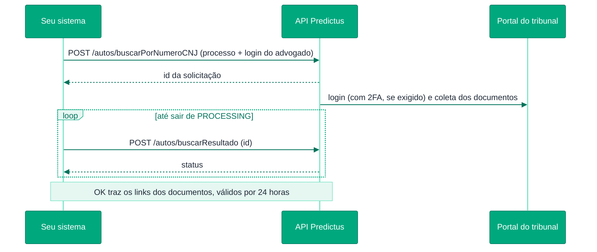

# 📂 Dossiê Jurídico – Autos Processuais

A consulta de autos da Predictus permite o acesso automático aos **documentos sigilosos do processo** (como petições iniciais, procurações, contestações, laudos, recursos etc.) através de login em nome do advogado da causa, com usuário e senha ou com o certificado digital A1 dele.

Essa operação é feita com **autenticação direta nos portais oficiais dos tribunais** (ESAJ, PJe, Projudi, EPROC), respeitando os mecanismos de segurança vigentes — como autenticação de dois fatores (2FA/OTP) quando exigido.

---

## 🧠 Quando usar essa funcionalidade?

- Obtenção de **documentos não públicos** do processo (não disponíveis em consultas abertas)
- Coleta de **peças processuais específicas** como procurações, defesas, sentenças assinadas
- Uso em robôs de automação ou análise interna
- **Autos completos** em PDF, gerados pelo próprio tribunal, com `modoAnexos: AUTOS_COMPLETOS` (PJe e Eproc)
- Extração segura e rastreável, sem violar segredo de justiça

---

## 🔐 Requisitos obrigatórios

- Login e senha do advogado cadastrado no processo **ou** o certificado A1 dele (`.pfx`/`.p12`) e a senha do certificado — certificado em PJe estadual e federal, Eproc e eSAJ ([ver tabela](#sistemas-suportados))
- Segundo fator, quando o sistema exige: `tokenMFA` (aplicativo OTP) ou `email` (código por e-mail, só no eSAJ por usuário e senha)
- Número único do processo (NPU/CNJ)

---

## ⚙️ Fluxo de consulta

1. **Inicie a requisição** de busca de autos com as credenciais e o número do processo
2. A Predictus tentará login no sistema correspondente (ESAJ, PJe, EPROC, etc.)
3. Será gerado um `id` de solicitação — aguarde o processamento
4. **Busque o resultado** com esse `id` para obter os documentos (normalmente disponíveis em poucos segundos)



---

## 🖥️ Sistemas suportados

Cada sistema aceita uma ou duas formas de login. O segundo fator (2FA) depende do sistema e, no eSAJ, também da forma de login. A tabela abaixo lista os sistemas mais utilizados; outros sistemas regionais e específicos também podem estar habilitados — entre em contato para confirmar.

| Sistemas | `usuario` | Usuário e senha | Certificado A1 |
| -------- | --------- | --------------- | -------------- |
| **PJe estadual** — `PJE-TJAP`, `PJE-TJBA`, `PJE-TJES`, `PJE-TJMA`, `PJE-TJMG`, `PJE-TJMT`, `PJE-TJPA`, `PJE-TJPE`, `PJE-TJPI`, `PJE-TJRJ`, `PJE-TJRN`, `PJE-TJRO` e o `-2G` de cada um (exceto `PJE-TJRJ`) | CPF | ✅ com `tokenMFA` | ✅ com `tokenMFA` |
| **PJe federal** — `PJE-TRF1`, `PJE-TRF3`, `PJE-TRF5`, `PJE-TRF6` e o `-2G` de cada um | CPF | ✅ com `tokenMFA` | ✅ com `tokenMFA` |
| **Eproc** — `EPROC-JFES`, `EPROC-JFMG`, `EPROC-JFPR`, `EPROC-JFRS`, `EPROC-JFSC`, `EPROC-TRF2`, `EPROC-TRF4`, `EPROC-TRF6`, `EPROC-TJMRS`, `EPROC-TJRJ`, `EPROC-TJAC`, `EPROC-TJSC`, `EPROC-TJSP`, `EPROC-TJRS`, `EPROC-TJTO` e o `-2G` dos cinco últimos | CPF ou OAB | ✅ com `tokenMFA` | ✅ com `tokenMFA` |
| **eSAJ** — `ESAJ-TJAC`, `ESAJ-TJAL`, `ESAJ-TJAM`, `ESAJ-TJCE`, `ESAJ-TJMS`, `ESAJ-TJSP`, o `-2G` de cada um e `ESAJ-TJSP-REC` | CPF | ✅ com `email` | ✅ sem 2FA |
| **PJe trabalhista** — `PJE-TRT1` a `PJE-TRT24`, o `-2G` de cada um e `PJE-TST` | CPF | ✅ sem 2FA | ❌ |
| **Projudi com 2FA** — `PROJUDI-TJPR`, `PROJUDI-TJRR`, o `-2G` de cada um e `PROJUDI-SEEU` | CPF | ✅ com `tokenMFA` | ❌ |
| **Projudi sem 2FA** — `PROJUDI-TJBA`, `PROJUDI-TJGO`, `PROJUDI-TJAM` e `PROJUDI-TJAM-2G` | CPF | ✅ sem 2FA | ❌ |
| **TJSE** — `TJSE` | CPF | ✅ sem 2FA | ❌ |
| **JusBR** — `JUSBR` | CPF | ✅ com `tokenMFA` | ❌ |

Como ler a tabela:

- **com `tokenMFA`** — 2FA por aplicativo OTP (TOTP): envie a chave do aplicativo em `tokenMFA`. Vale para as duas formas de login.
- **com `email`** — 2FA por código enviado ao e-mail do advogado: envie em `email` um endereço com redirecionamento automático para a Predictus ([como configurar](./recursos/buscar-autos#campos-condicionais)).
- **sem 2FA** — basta o login; `tokenMFA` e `email` são ignorados se enviados.
- **❌** — essa forma de login não é aceita no sistema e a requisição retorna `400`.

> ⚠️ **A tabela vale como validação.** A API confere o login e o segundo fator antes de tentar acessar o tribunal e responde `400`, sem cobrança, quando falta o campo exigido:
> - `O tokenMFA é obrigatório para o sistema {sistema}`
> - `O email é obrigatório para o sistema {sistema}`
> - `O login por certificado não é aceito para o sistema {sistema}`

> ⚠️ O `JUSBR` funciona como um _fallback_ — pode retornar processos mais recentes (digitais, pós-2015) de forma unificada, mas **não possui cobertura completa** e costuma ser mais instável.


## 🔄 Status possíveis na resposta

| Status | Significado |
|--------|-------------|
| `PROCESSING` | Ainda em andamento |
| `OK`         | Documentos recuperados com sucesso |
| `BAD CREDENTIALS` | Login, senha, certificado ou token incorretos |
| `SPECIAL ERROR` | Processo com segredo de justiça |
| `WRONG CAPTCHA` / `UNKNOWN ERROR` | Erro técnico no tribunal |

> Os links para download ficam disponíveis por até **24 horas**.

---

## 📥 Exemplo de resposta com sucesso

```json
{
  "data": [
    {
      "numeroProcessoUnico": "50379103520218130702",
      "sistema": "PJE-TJMG",
      "grauProcesso": 1,
      "tribunal": "TJ-MG",
      "classeProcessual": {
        "nome": "[CIVEL] CUMPRIMENTO DE SENTENCA",
        "codigoCNJ": "12078"
      },
      "movimentos": [
        {
          "nomeOriginal": [
            "JUNTADA DE PETICAO DE MANIFESTACAO DA ADVOCACIA PUBLICA"
          ],
          "anexo": [
            {
              "titulo": "MANIFESTACAO DA ADVOCACIA PUBLICA",
              "extensao": "PDF",
              "nomeArquivo": "manifestacao.pdf",
              "caminho": "https://link-assinado-temporario"
            }
          ]
        }
      ]
    }
  ],
  "message": "OK",
  "status": 200
}
```

---

## 📄 Atenção

- A Predictus **não armazena senhas, certificados ou tokens** enviados — são usados apenas durante a consulta.
- Para portais que exigem 2FA, você deverá configurar previamente uma credencial com autenticação por OTP.
- O número do processo deve estar corretamente formatado no padrão CNJ.

---

## 🚀 Prossiga

Acesse os endpoints abaixo para consultar:

- [🔐 Buscar por Número CNJ](./recursos/buscar-autos)
- [📦 Buscar Resultado (Download dos Autos)](./recursos/buscar-resultado)
