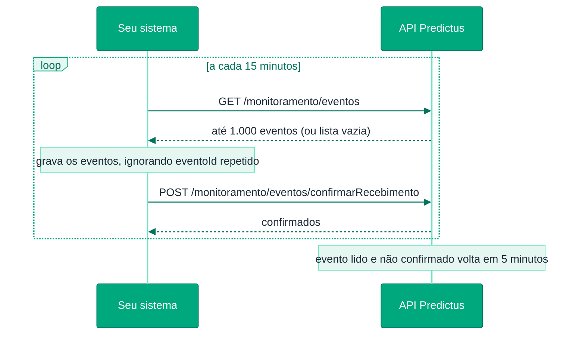

# 🚀 Comece aqui

Para usar o Monitoramento, bastam **3 chamadas**:

1. **Cadastrar** o que você quer monitorar.
2. **Ler** os eventos de tempos em tempos.
3. **Confirmar** os eventos que você já processou.

Não precisa configurar webhook nem guardar segredo: a leitura periódica já entrega tudo. O [webhook](./webhook) é opcional, para quem prefere receber os eventos por `POST`.

Todas as chamadas usam o `accessToken` obtido em [Autenticação](../authentication).

---

## 1️⃣ Cadastre uma empresa

Monitore todos os processos de uma empresa pela raiz do CNPJ (os 8 primeiros caracteres). Exemplo com todos os campos que a entidade aceita:

```bash
curl --location 'https://api.predictus.com.br/predictus-api/monitoramento/entidades' \
--header 'Content-Type: application/json' \
--header 'Authorization: Bearer {accessToken}' \
--data '{
  "entidades": [
    {
      "tipo": "EMPRESA",
      "clienteFinal": "escritorio-0042",
      "referenciaExterna": "pasta-778",
      "operacao": "ATUALIZACOES",
      "origensDocumento": ["TRIBUNAL", "CATALOGO"],
      "raizCnpj": "12345678",
      "nomes": ["ACME COMERCIO DE ALIMENTOS LTDA", "ACME COMERCIO DE ALIMENTOS LTDA."],
      "filtros": { "polos": ["PASSIVO"], "ufs": ["SP", "RJ"], "valorCausa": { "maiorIgualQue": 50000 } }
    }
  ]
}'
```

- `operacao` (**obrigatório**): `NOVOS` (só processos e recursos novos) ou `ATUALIZACOES` (novos **e** novidades nos processos).
- `origensDocumento` (**obrigatório**): de onde pode vir o documento que casa com a empresa (`TRIBUNAL`, `CATALOGO`, `AGREGADO`).
- `clienteFinal` e `referenciaExterna` (opcionais): **de quem** é a entidade e **qual registro** do seu sistema ela representa. Voltam em todo evento — veja [Estrutura](./estrutura).
- `nomes` e `filtros` (opcionais): veja [Estrutura](./estrutura).

Mínimo:

```json
{ "entidades": [ { "tipo": "EMPRESA", "operacao": "ATUALIZACOES", "origensDocumento": ["TRIBUNAL"], "raizCnpj": "12345678" } ] }
```

Resposta:

```json
{
  "entidades": [
    { "indice": 0, "entidadeId": "6f1c2a9e-0b7d-4c1e-9f3a-2d4b5c6e7f80", "clienteFinal": "escritorio-0042", "referenciaExterna": "pasta-778" }
  ]
}
```

Pronto: a empresa está monitorada. Você recebe eventos sobre o que acontecer **a partir de agora** — processos novos e novidades nos processos dela.

---

## 2️⃣ Leia os eventos

Chame periodicamente (por exemplo, a cada 15 minutos):

```bash
curl --location 'https://api.predictus.com.br/predictus-api/monitoramento/eventos' \
--header 'Authorization: Bearer {accessToken}'
```

Resposta:

```json
{
  "eventos": [
    {
      "eventoId": "2b0e8f4a-7c1d-5e3f-9a2b-4c6d8e0f1a2b",
      "entidadeId": "6f1c2a9e-0b7d-4c1e-9f3a-2d4b5c6e7f80",
      "clienteFinal": "escritorio-0042",
      "referenciaExterna": "pasta-778",
      "tipoNotificacao": "PROCESSO_NOVO",
      "numeroProcessoUnico": "00012340320268260100",
      "tribunal": "TJ-SP",
      "grauProcesso": 1,
      "classeProcessual": { "nome": "PROCEDIMENTO COMUM CIVEL", "codigoCNJ": "7" },
      "dataDistribuicao": "2026-11-02",
      "casouPor": { "tipo": "RAIZ_CNPJ", "valor": "12345678", "origem": "TRIBUNAL" },
      "dataProcessamento": "2026-11-03T03:14:00Z"
    }
  ]
}
```

Cada evento diz **qual processo** (`numeroProcessoUnico`), **de qual entidade** (`entidadeId`, com a sua `referenciaExterna`) e **o tipo** (`PROCESSO_NOVO`, `RECURSO_NOVO` ou `ATUALIZACAO`). Para ver o conteúdo do processo, consulte-o pelo número em [Buscar por Número CNJ (Capa)](https://docs.predictus.inf.br/dossie-juridico/recursos/buscar-movimentacoes-simplificado).

Se a lista vier vazia (`"eventos": []`), não há nada novo — tente de novo mais tarde.

---

## 3️⃣ Confirme o recebimento

Depois de gravar os eventos no seu sistema, confirme pelos `eventoId`:

```bash
curl --location 'https://api.predictus.com.br/predictus-api/monitoramento/eventos/confirmarRecebimento' \
--header 'Content-Type: application/json' \
--header 'Authorization: Bearer {accessToken}' \
--data '{
  "eventoIds": ["2b0e8f4a-7c1d-5e3f-9a2b-4c6d8e0f1a2b"]
}'
```

Resposta:

```json
{ "confirmados": 1 }
```

Eventos confirmados não voltam. Eventos lidos e **não** confirmados voltam a aparecer depois de 5 minutos — assim nada se perde se o seu processamento falhar.

---

## 🔁 O laço completo



```
a cada 15 minutos:
  repetir:
    GET  /monitoramento/eventos
    se a lista vier vazia → parar
    gravar os eventos (ignorando eventoId já gravado)
    POST /monitoramento/eventos/confirmarRecebimento com os eventoIds
```

> 💡 **Ignore `eventoId` repetido.** Em casos raros o mesmo evento pode chegar duas vezes; guardar o `eventoId` resolve.

---

## 🧭 Próximos passos

<CardGroup cols={3}>
  <Card title="Introdução" icon="book-open" href="./overview">
    Tipos de entidade, níveis de notificação e quando um evento é gerado.
  </Card>
  <Card title="Cadastrar Entidades" icon="plus" href="./recursos/cadastrar-entidades">
    Pessoas, advogados, processos, nomes e filtros.
  </Card>
  <Card title="Webhook (opcional)" icon="bolt" href="./webhook">
    Receba os eventos por POST em vez de ler.
  </Card>
</CardGroup>
