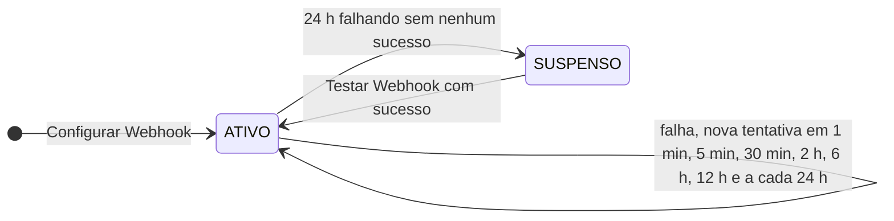

# 🔔 Webhook (opcional)

**O webhook é opcional.** Você já recebe todos os eventos lendo [Ler Eventos](./recursos/ler-eventos) de tempos em tempos — veja [Comece aqui](./comece-aqui). O webhook é uma alternativa para quem prefere **receber** os eventos: a Predictus envia por `POST` para a sua URL, em lotes de até **500 eventos**.

O básico:

1. [Configure](./recursos/configurar-webhook) a URL e [teste](./recursos/testar-webhook).
2. Receba o `POST` e responda **`2xx`**.
3. Ignore `eventoId` repetido.

Uma URL por conta: use `clienteFinal` e `referenciaExterna` do evento para rotear internamente. A verificação da assinatura é recomendada e está no fim desta página.

> ⚠️ **Trocar a senha da credencial remove o webhook.** Os eventos continuam disponíveis na [leitura](./recursos/ler-eventos); [configure o webhook](./recursos/configurar-webhook) de novo para voltar a recebê-los.

---

## 📨 O que enviamos

```http
POST <sua URL>
Content-Type: application/json
User-Agent: Predictus-Monitoramento/2
X-Predictus-Entrega-Id: 7d3e2a10-5b6c-4d7e-8f90-a1b2c3d4e5f6
X-Predictus-Assinatura: t=1762178531,v1=5f2b9c...
```

```json
{
  "entregaId": "7d3e2a10-5b6c-4d7e-8f90-a1b2c3d4e5f6",
  "teste": false,
  "eventos": [
    {
      "eventoId": "2b0e8f4a-7c1d-5e3f-9a2b-4c6d8e0f1a2b",
      "entidadeId": "6f1c2a9e-0b7d-4c1e-9f3a-2d4b5c6e7f80",
      "clienteFinal": "escritorio-0042",
      "referenciaExterna": "pasta-778",
      "tipoNotificacao": "PROCESSO_NOVO",
      "numeroProcessoUnico": "00012340320268260100",
      "tribunal": "TJ-SP",
      "grauProcesso": 1,
      "classeProcessual": { "nome": "PROCEDIMENTO COMUM CIVEL", "codigoCNJ": "7" },
      "dataDistribuicao": "2026-11-02",
      "casouPor": { "tipo": "RAIZ_CNPJ", "valor": "12345678", "origem": "TRIBUNAL" },
      "dataProcessamento": "2026-11-03T03:14:00Z"
    },
    {
      "eventoId": "9c41d2e3-4f5a-5b6c-8d7e-9f0a1b2c3d4e",
      "entidadeId": "0a9b8c7d-6e5f-4a3b-2c1d-0e9f8a7b6c5d",
      "clienteFinal": "escritorio-0042",
      "referenciaExterna": "pasta-779",
      "tipoNotificacao": "ATUALIZACAO",
      "numeroProcessoUnico": "50012349320258210001",
      "tribunal": "TJ-RS",
      "grauProcesso": 2,
      "classeProcessual": { "nome": "APELACAO CIVEL", "codigoCNJ": "198" },
      "dataDistribuicao": "2026-05-14",
      "casouPor": { "tipo": "NUMERO_PROCESSO_UNICO", "valor": "50012349320258210001", "origem": null },
      "dataProcessamento": "2026-11-03T03:14:00Z"
    }
  ]
}
```

| Campo / cabeçalho | Descrição |
|-------------------|-----------|
| `entregaId` / `X-Predictus-Entrega-Id` | Identificador desta tentativa de entrega. Use em logs e no contato com o suporte; aparece no [histórico de entregas](./recursos/historico-entregas) |
| `teste` | `true` só no envio de [Testar Webhook](./recursos/testar-webhook), sempre com `eventos` vazio |
| `eventos` | De 0 a 500 eventos. Formato em [Estrutura do Evento](./estrutura) |
| `X-Predictus-Assinatura` | Assinatura do corpo (veja abaixo) |

---

## ✅ Como responder

- Responda com **qualquer `2xx` em até 10 segundos**. Isso confirma o lote inteiro; o corpo da sua resposta é ignorado.
- Qualquer outra resposta é falha: status fora de `2xx`, timeout, erro de conexão ou TLS.
- **Redirecionamentos (`3xx`) não são seguidos** e contam como falha.
- Responda rápido e processe depois: grave o lote e devolva `200`.

---

## 🔁 Duplicidade e ordem

- **Um evento pode chegar mais de uma vez** — por exemplo, se a sua resposta não chegar até nós a tempo. Deduplique pelo `eventoId`.
- **Não há garantia de ordem.** Se precisar, ordene pelo `dataProcessamento`.
- A [leitura de eventos](./recursos/ler-eventos) continua disponível com o webhook ativo. Os dois canais disputam os mesmos eventos: cada evento sai por um deles, não pelos dois.

---

## 🛡️ Requisitos da URL

- Somente `https`, na porta **443**.
- Sem usuário e senha na URL, e o host não pode ser um IP literal.
- O endereço não pode resolver para IP privado ou interno.
- Até 2.048 caracteres.

URLs fora dessas regras são recusadas com `400`.

### 🌐 IPs de origem

As entregas saem **sempre** destes IPs. Libere-os no firewall do seu endpoint:

```
44.210.57.73
98.89.114.217
```

> ⚠️ Esses IPs são **diferentes** dos IPs da API da Predictus.

---

## ⏳ Novas tentativas e suspensão



Um lote que falha volta a ser enviado depois de **1 min, 5 min, 30 min, 2 h, 6 h e 12 h**, e depois a cada **24 h**, com uma pequena variação aleatória. Eventos não entregues ficam disponíveis por **14 dias**.

- O intervalo vale para o lote inteiro: um evento que caiu no mesmo lote de um evento já retentado espera junto com ele. Eventos de outros lotes seguem normalmente.
- Falhas do lado da Predictus não contam: o envio é repetido em 1 minuto, sem avançar o intervalo.
- **Suspensão:** se o webhook passar **24 horas falhando sem nenhum sucesso**, ele fica `SUSPENSO` e paramos de enviar. Os eventos continuam pendentes e podem ser lidos por [Ler Eventos](./recursos/ler-eventos).
- **Para reativar**, corrija o endpoint e chame [Testar Webhook](./recursos/testar-webhook): um teste bem-sucedido volta o webhook para `ATIVO`.

---

## 🔏 Verificando a assinatura

Cada entrega traz o cabeçalho:

```
X-Predictus-Assinatura: t=<segundos Unix>,v1=<assinatura>
```

Onde:

```
v1 = hex( HMAC-SHA256( segredo, t + "." + corpo_bruto ) )
```

Para validar:

1. Use o **corpo bruto**, exatamente os bytes recebidos — valide **antes** de interpretar o JSON.
2. Recuse se `t` estiver a mais de **300 segundos** do seu relógio (protege contra reenvio de uma entrega antiga).
3. Compare em **tempo constante**.
4. Durante a [rotação do segredo](./recursos/girar-segredo), o cabeçalho traz **dois `v1`** (segredo novo e anterior). A entrega é válida se **qualquer um** bater.

<CodeGroup>

```python Python
import hashlib
import hmac
import time


def assinatura_valida(cabecalho: str, corpo: bytes, segredo: str) -> bool:
    partes = [p.strip().split("=", 1) for p in cabecalho.split(",") if "=" in p]
    t = next((v for k, v in partes if k == "t"), None)
    if t is None or not t.isdigit() or abs(time.time() - int(t)) > 300:
        return False
    esperado = hmac.new(segredo.encode(), f"{t}.".encode() + corpo, hashlib.sha256).hexdigest()
    return any(hmac.compare_digest(esperado, v) for k, v in partes if k == "v1")
```

```javascript Node.js
const crypto = require("crypto");

// Em Express, receba o corpo bruto: app.post(rota, express.raw({ type: "application/json" }), ...)
function assinaturaValida(cabecalho, corpoBruto, segredo) {
  const partes = cabecalho.split(",").map((p) => {
    const i = p.indexOf("=");
    return [p.slice(0, i).trim(), p.slice(i + 1).trim()];
  });
  const t = partes.find(([k]) => k === "t")?.[1];
  if (!/^\d+$/.test(t ?? "") || Math.abs(Date.now() / 1000 - Number(t)) > 300) return false;
  const esperado = Buffer.from(
    crypto.createHmac("sha256", segredo).update(`${t}.`).update(corpoBruto).digest("hex")
  );
  return partes
    .filter(([k]) => k === "v1")
    .some(([, v]) => {
      const recebido = Buffer.from(v);
      return recebido.length === esperado.length && crypto.timingSafeEqual(recebido, esperado);
    });
}
```

```java Java
import java.nio.charset.StandardCharsets;
import java.security.MessageDigest;
import java.time.Instant;
import java.util.HexFormat;
import javax.crypto.Mac;
import javax.crypto.spec.SecretKeySpec;

static boolean assinaturaValida(String cabecalho, byte[] corpo, String segredo) throws Exception {
  Long t = null;
  java.util.List<String> assinaturas = new java.util.ArrayList<>();
  for (String parte : cabecalho.split(",")) {
    int i = parte.indexOf('=');
    if (i < 0) continue;
    String chave = parte.substring(0, i).trim();
    String valor = parte.substring(i + 1).trim();
    if (chave.equals("t")) {
      try { t = Long.parseLong(valor); } catch (NumberFormatException e) { return false; }
    } else if (chave.equals("v1")) {
      assinaturas.add(valor);
    }
  }
  if (t == null || Math.abs(Instant.now().getEpochSecond() - t) > 300) return false;

  Mac mac = Mac.getInstance("HmacSHA256");
  mac.init(new SecretKeySpec(segredo.getBytes(StandardCharsets.UTF_8), "HmacSHA256"));
  mac.update((t + ".").getBytes(StandardCharsets.UTF_8));
  byte[] esperado = HexFormat.of().formatHex(mac.doFinal(corpo)).getBytes(StandardCharsets.US_ASCII);

  boolean valida = false;
  for (String v : assinaturas) {
    valida |= MessageDigest.isEqual(esperado, v.getBytes(StandardCharsets.US_ASCII));
  }
  return valida;
}
```

</CodeGroup>

> 💡 Guarde o segredo como qualquer credencial: fora do código-fonte, em um cofre de segredos. Ele é exibido **uma única vez**, na configuração do webhook ou na rotação.

---

## 🚀 Recursos do webhook

<CardGroup cols={3}>
  <Card title="Configurar Webhook" icon="gear" href="./recursos/configurar-webhook">
    Cadastre ou troque a URL.
  </Card>
  <Card title="Testar Webhook" icon="vial" href="./recursos/testar-webhook">
    Envie um lote de teste e veja o resultado.
  </Card>
  <Card title="Histórico de Entregas" icon="clock-rotate-left" href="./recursos/historico-entregas">
    Tentativas dos últimos 7 dias.
  </Card>
</CardGroup>
